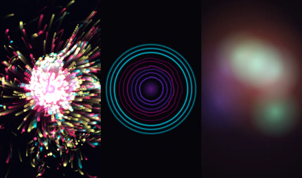

# LRR Visualizer

Turn a song into an abstract, audio-reactive music video. Drop in a WAV or MP3 and you get:

- **A YouTube video**: 1920×1080 (landscape), the whole song.
- **A Shorts / Reels / TikTok video**: 1080×1920 (vertical), a 60-second clip of the most energetic part of the song.

Shapes and colours react to the music. The **bass** (kick drum, bassline), the **mids** (vocals, synths, guitars) and the **highs** (hi-hats, cymbals, air) each drive a different part of the picture.


Everything it uses is free and open source, and commercial use is allowed (see [Licences](#licences)). There are no watermarks, no accounts and no subscriptions.

---

## 1. One-time setup (Windows)

You only do this once.

1. **Install Node.js.** Go to **https://nodejs.org**, click the big button marked **LTS**, run the installer and keep all the default options.
2. **Put this folder on your computer.** For example, `D:\apps\lrr-visualizer`.
   - If you got it from GitHub, click the green **Code** button, then **Download ZIP**, and unzip it into `D:\apps\`. Rename the folder to `lrr-visualizer` if it has a different name.
3. **Double-click `Install.bat`** inside the folder.
   A black window opens and downloads what the tool needs (about 300–400 MB, a few minutes). When it says **Setup complete**, close the window.

> If Windows shows a blue "Windows protected your PC" box when you open a `.bat` file, click **More info**, then **Run anyway**. These are plain text files; you can open them in Notepad to see exactly what they do.

## 2. Making a video

1. **Drag your song** (WAV or MP3) **onto `Make Video.bat`**. You can drag several songs at once.
2. A window opens and asks you three things:
   - **Which look?** Type `1`, `2`, `3` or `4` (all three) and press Enter.
   - **Preview first?** Type `Y` to make a quick 15-second test clip. This is a good idea the first time, to check you like the look. Or just press Enter to make the full videos.
   - **Where should the vertical clip start?** Press Enter and the tool picks the most energetic 60 seconds for you. Or type a start time like `1:05`.
3. Wait. A progress bar shows how far along it is and roughly how long is left.
4. When it's done, the **`output`** folder opens. Each song gets its own folder with videos named like:
   - `My Song - particles - YouTube 1920x1080.mp4`
   - `My Song - particles - Vertical 1080x1920.mp4`

### How long does it take?

Roughly **10–15 minutes per look** for a 4-minute song, for both videos together. A faster computer is quicker. Choosing **4 = All three** takes about three times as long. You can keep using your computer while it works, and it's fine to leave it running.

## 3. The three looks

| Look | Bass | Mids | Highs | Kick drum |
|---|---|---|---|---|
| **Particles** | How many particles fly out of the centre, how fast, and the size of the glowing core | How strongly the swirling "wind" pushes particles around | Particle sparkle and twinkling stars | Big burst + flash ring |
| **Waveform rings** | The inner rings ripple and swell | The middle rings change shape and the spin speeds up | The outer rings shimmer | Everything pulses + shockwave ring |
| **Colour fields** | Two huge, slow clouds of colour swell | Three medium clouds drift faster | Small bright clouds + film-grain shimmer | The whole picture brightens for a moment |

Vertical versions use the same looks, laid out for a phone screen:



## 4. Uploading

- **YouTube:** upload the `YouTube 1920x1080` file as a normal video.
- **YouTube Shorts:** upload the `Vertical 1080x1920` file. Shorts must be 3 minutes or shorter, and the default 60-second clip fits.
- **Instagram Reels / TikTok / Facebook Reels:** upload the `Vertical 1080x1920` file.

The videos are H.264 MP4 with high-quality AAC audio, which every platform accepts. Each video fades in from black and fades out at the end. A clip taken from the middle of a song also gets a short audio fade so it doesn't start or stop abruptly.

---

## 5. Extra options (optional)

Everything above works with drag-and-drop. If you want more control, such as your own colours, a specific section of the song or only one of the two formats, you can type a command instead.

**How to open a command window in the right place:** open the `lrr-visualizer` folder in File Explorer, click in the address bar at the top, type `cmd` and press Enter.

Then type a command like one of these and press Enter. Put the song's file path in quotes. A quick way to get it is to drag the song file into the command window.

```
node src\cli.js "D:\Music\My Song.wav" --preset rings
```

```
node src\cli.js "D:\Music\My Song.wav" --preset fields --colors "#ff0055,#00ffcc,#ffffff,#000000"
```

```
node src\cli.js "D:\Music\My Song.mp3" --preset all --format vertical --vertical-start 1:30 --vertical-length 30
```

```
node src\cli.js "D:\Music\Album" --preset particles
```
(That last one makes videos for every song in a folder.)

| Option | What it does | Default |
|---|---|---|
| `--preset particles` / `rings` / `fields` / `all` | Which look. You can also list several: `--preset rings,fields` | `particles` |
| `--format both` / `youtube` / `vertical` | Which videos to make | `both` |
| `--preview` | Make 15-second test clips instead of full videos | off |
| `--colors "bass,mids,highs"` | Your own colours as hex codes (find them at e.g. htmlcolorcodes.com). Add a 4th for the background. | each look has its own palette |
| `--start 0:45` / `--length 2:00` | YouTube version: only render part of the song | whole song |
| `--vertical-start 1:05` | Vertical version: start time, or `auto` | `auto` (most energetic part) |
| `--vertical-length 30` | Vertical version: length, or `full` for the whole song | `60` seconds |
| `--fps 60` | Frames per second (smoother, but takes twice as long) | `30` |
| `--seed 7` | Changes the random pattern if you want a different variation | `1` |
| `--jobs 3` | How many videos to work on at once (more is faster on powerful PCs) | `2` |
| `--out "D:\Videos"` | Where to save the videos | the `output` folder |

Times can be written as seconds (`95`) or minutes:seconds (`1:35`). To see all of this in the command window, run `node src\cli.js --help`.

## 6. Troubleshooting

| Problem | Fix |
|---|---|
| "Node.js is not installed yet" | Install the LTS version from https://nodejs.org, then **restart your computer** and try again. |
| Setup fails or stops partway | Usually a network hiccup. Double-click `Install.bat` again. If you're on a work network, try another connection. |
| "Could not read the audio file" | The file may be damaged or an unusual format. Re-export it from your DAW as WAV (16- or 24-bit) or MP3. |
| Nothing moves much | The visuals adapt to each song's own loud and quiet parts, so a track with very little dynamic change gives calmer visuals. Try `rings` or `particles`, which react most to the kick drum. |
| Rendering is slow | Use `--preview` while choosing a look, render one look instead of all three, or close other heavy programs. `--jobs 1` uses less memory on older PCs. |
| The window closes immediately | Drag the song onto `Make Video.bat`. Double-clicking it on its own only shows instructions. |

Mac or Linux: install Node.js, then in a terminal in this folder run `npm install` once, then `node src/cli.js "/path/to/song.wav" --preset rings`.

---

## Licences

Every part of this tool is free and open source, and allows commercial use. **The videos you make are yours.** You can monetise them on YouTube, use them in ads, or sell them.

| Part | What it does | Licence |
|---|---|---|
| This tool's own code | Audio analysis, the three looks, the launcher | GPL-3.0 (see `LICENSE`) |
| [p5.js](https://p5js.org) | Drawing library used by the looks | LGPL-2.1 |
| [Puppeteer](https://pptr.dev) | Runs a hidden browser to draw each frame | Apache-2.0 |
| [Chrome for Testing](https://developer.chrome.com/blog/chrome-for-testing) | The hidden browser Puppeteer downloads (built from Chromium) | BSD-3-Clause and other open-source licences |
| [FFmpeg](https://ffmpeg.org) via [ffmpeg-static](https://github.com/eugeneware/ffmpeg-static) | Reads your audio and encodes the MP4 | GPL-3.0 build (includes x264) |
| [Node.js](https://nodejs.org) | Runs the tool | MIT |

Notes:
- The GPL and LGPL licences put no restrictions on *using* the tool or on the videos it makes. They only matter if you redistribute the software itself, for example by bundling it into a product you sell. In that case you must also share the source of those parts, which is already public.
- The videos use H.264, the standard format every platform asks for. Uploading H.264 videos to YouTube, Instagram and similar sites is standard practice for musicians and labels.

---

## For developers

How it works:

1. **`src/audio.js`** decodes the song with ffmpeg to mono 44.1 kHz and runs an FFT for every video frame. It works out bass (20–250 Hz), mid (250 Hz–4 kHz) and high (4–16 kHz) energy, a 64-band log spectrum, a waveform snapshot and kick detection. Values are normalised to each track's own dynamic range (10th–98th percentile, in dB) and smoothed with attack/release envelopes. All analysis happens up front, so rendering is deterministic and doesn't depend on real-time playback.
2. **`src/render.js`** launches headless Chrome with Puppeteer and loads p5.js (instance mode, `noLoop`) plus a preset. It sends frames in small batches, calls `redraw()` once per frame and pipes each canvas as a JPEG into ffmpeg (`image2pipe` → libx264 CRF 18, `yuv420p`, AAC 320k, `+faststart`).
3. **`src/cli.js`** handles options, picks the vertical highlight (the loudest window, snapped to a kick) and renders the jobs in parallel pages.

To add a preset, create `src/presets/<name>.js` that registers `LRR.presets.<name> = { label, palette: { bg, bass, mid, high }, setup(p, env), draw(p, a, env) }`, then add it to `PRESETS` in `src/render.js`.
- `a` holds the current frame: `t`, `bass`, `mid`, `high`, `level`, `kick`, `beat`, `spectrum[64]` and `wave[128]`.
- `env` holds `width`, `height`, `unit` (the shorter side, so layouts work in both orientations), `colors` and a `state` object you can keep data in between frames.
- Draw through `p.drawingContext` (the Canvas 2D context) for fills, gradients and blend modes. p5 caches fill and blend state, so mixing `p.fill()` / `p.blendMode()` with direct context calls leads to stale styles.

Environment overrides: `LRR_CHROME` points to a different Chrome or Chromium binary. `LRR_FFMPEG` points to a different ffmpeg.
